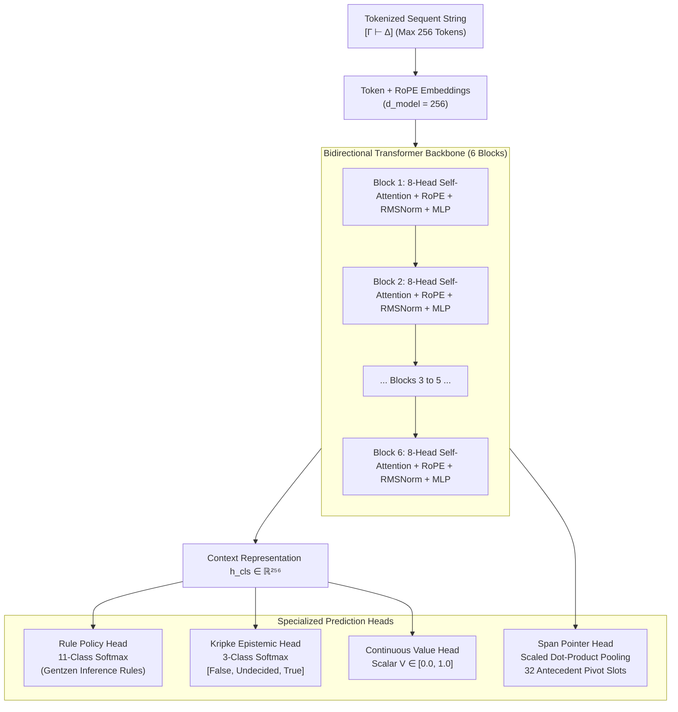
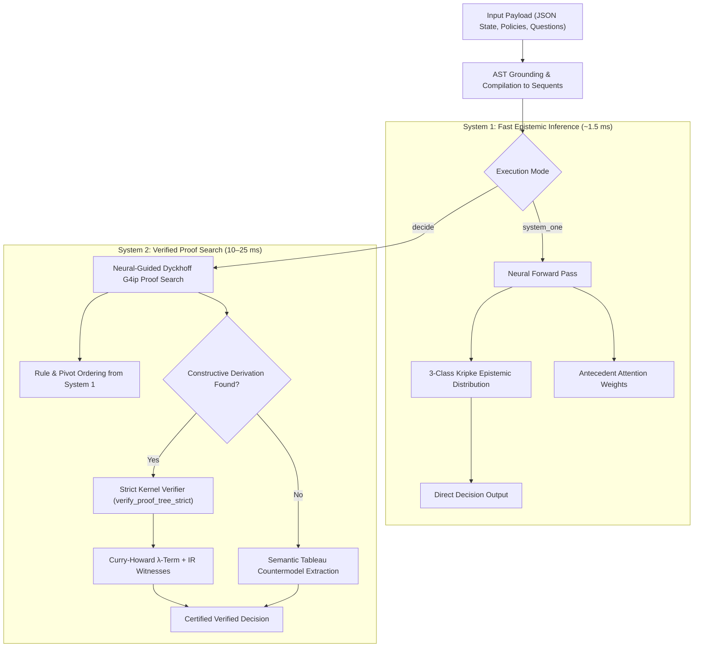

# Architecture of nanoGentzen-v3

`nanoGentzen-v3` is an ultra-compact **4.93M parameter** (`4,927,812` parameters) neuro-symbolic transformer engineered specifically for certified discrete decision-making, formal policy verification, and epistemic valuation.

---

## 1. High-Level Architecture Overview

---

## 2. Model Specifications & Parameter Breakdown

The complete model requires only **19.6 MB** in `model.safetensors` format:

| Component | Specification | Dimension / Count | Parameters |
| :--- | :--- | :--- | :---: |
| **Token Embeddings** | Vocabulary of logical connectives, operators, & variables | \(V = 95, \; d = 256\) | \(24,320\) |
| **Rotary Position Embeddings (RoPE)** | Dynamic rotary frequencies for long-context sequents | \(d_{\text{head}} = 32\) | \(0\) (Fixed) |
| **Transformer Blocks (6 Layers)** | Bidirectional Pre-LN Multi-Head Self-Attention + SwiGLU / MLP | \(L = 6, \; d_{\text{model}} = 256, \; d_{\text{ff}} = 1024\) | \(4,725,504\) |
| **Span Pointer Attention Head** | Scaled dot-product antecedent pooling across 32 slots | \(d_{\text{pointer}} = 64, \; N_{\text{slots}} = 32\) | \(82,496\) |
| **Kripke Epistemic Head** | Linear projection to 3 epistemic classes | \(d_{\text{model}} \to 3\) | \(771\) |
| **Rule Policy Head** | Linear projection to 11 Gentzen inference rules | \(d_{\text{model}} \to 11\) | \(2,827\) |
| **Continuous Value Head** | Scalar regression with sigmoid bounding | \(d_{\text{model}} \to 1\) | \(257\) |
| **LayerNorms & Biases** | Pre-LN / Final LN normalizations | \(d = 256\) | \(3,072\) |
| **Total Parameter Count** | — | — | **4,927,812** |

---

## 3. Specialized Architectural Innovations

### A. Boundary-Aware Span Pointer Head (Antecedent Pivot Attention)
Left-hand Gentzen inference rules (such as \(L_{\to}\) or \(L_{\land}\)) require selecting a specific antecedent formula from \(\Gamma = (A_0, A_1, \dots, A_k)\) to act as the pivot:

1. **Span Identification:** The tokenizer identifies antecedent comma delimiters, partitioning the sequence into \(k \le 32\) distinct antecedent spans.
2. **Mean-Pooled Antecedent Representations:** For each span \(j \in [0, k-1]\):
   $$
   \mathbf{e}_j = \frac{1}{|S_j|} \sum_{t \in S_j} \mathbf{h}_t \in \mathbb{R}^{d_{\text{model}}}
   $$
3. **Pointer Scoring:** The pooled context vector \(\mathbf{h}_{\text{cls}}\) queries all antecedent representations:
   $$
   \text{score}_j = \frac{\mathbf{q}(\mathbf{h}_{\text{cls}})^\top \mathbf{k}(\mathbf{e}_j)}{\sqrt{d_{\text{pointer}}}} + \mathbf{b}_j
   $$
   Where \(\mathbf{b}_j\) is a learned antecedent positional bias.
4. **Softmax Distribution:** Produces a calibrated probability distribution over pivot indices \(0 \dots 31\).

### B. Saul Kripke 3-Class Epistemic Valuation Head
Rather than estimating a naive scalar probability, the model outputs a 3-class distribution over intuitionistic epistemic states:

$$
\mathbf{p}_{\text{epistemic}} = \text{Softmax}\left( \mathbf{W}_{\text{ep}} \mathbf{h}_{\text{cls}} + \mathbf{b}_{\text{ep}} \right) \in \Delta^2
$$

- \(p_0 = P(\text{PROVEN\_FALSE})\)
- \(p_1 = P(\text{INTUITIONISTIC\_UNDECIDED})\)
- \(p_2 = P(\text{PROVEN\_TRUE})\)

#### Epistemic Sharpness Metric
The epistemic uncertainty or sharpness \(S \in [0, 1]\) is computed directly from the undecided probability:

$$
S = 1.0 - p_1
$$

When \(S \approx 1.0\), the sequent is decisively determined (either provable or refutable). When \(S \approx 0.0\), the sequent suffers from incomplete premises or classical ambiguity.

---

## 4. Dual-System Execution Path

### System 1 vs System 2 Latency & Throughput Profile

| Feature | System 1 (Fast Neural Pass) | System 2 (Formal Verified Search) |
| :--- | :---: | :---: |
| **Typical Latency (GPU)** | `0.9 ms – 1.4 ms` | `10 ms – 25 ms` |
| **Typical Latency (CPU)** | `0.7 ms – 10.2 ms` | `20 ms – 88 ms` |
| **Decisions per Second** | ~`780 dec/s` | ~`200 dec/s` |
| **Soundness Guarantee** | High epistemic correlation | **100% Mathematically Certified** |
| **Witness Artifacts** | Attention weights | Proof Tree DAG, Curry-Howard \(\lambda\)-term, *IR* witnesses |
| **Failure Mode** | Calibrated soft distribution | Explicit 2-world countermodel with missing premises |

