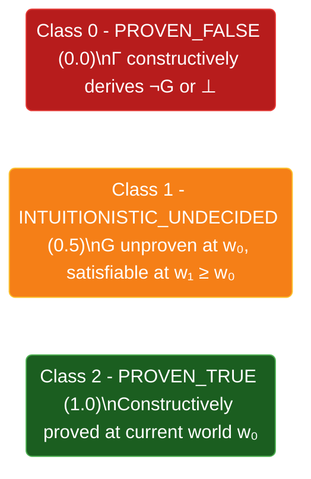

# Theoretical Methodology of nanoGentzen-v3

`nanoGentzen-v3` unifies constructive proof theory, relational semantics, relevance logic, and type theory into a single neuro-symbolic decision engine. This document details the mathematical and logical foundations underpinning its reasoning, verification, and witness extraction capabilities.

---

## 1. Gerhard Gentzen (1935) Intuitionistic Sequent Calculus (\(\mathbf{LJ}\))

In classical logic (\(\mathbf{LK}\)), propositions are assumed to be either true or false by default via the Law of Excluded Middle (\(P \lor \neg P\)) and Double Negation Elimination (\(\neg\neg P \vdash P\)). In enterprise decision systems, asserting a proposition without constructive evidence leads to unsubstantiated assertions and hallucinations.

Gentzen's intuitionistic sequent calculus (\(\mathbf{LJ}\)) enforces that every proved assertion must possess an explicit constructive derivation:

- **Sequent Structure:** \(\Gamma \vdash \Delta\), where \(\Gamma = (A_1, A_2, \dots, A_n)\) is a sequence of antecedent formulas (assumed facts and policies), and \(\Delta = (B)\) contains at most one succedent formula (the target decision goal).
- **Constructive Truth:** A proposition is proved if and only if there exists a finite derivation tree grounded in identity axioms (\(A \vdash A\)) using sound inference rules.

### Core Inference Rules of Intuitionistic Sequent Calculus

```mermaid
flowchart TD
    Ax["Identity Axiom: A ⊢ A"]
    R_Imp["R_IMP: Γ, A ⊢ B  ==>  Γ ⊢ A → B"]
    L_Imp["L_IMP: Γ ⊢ A  and  Γ, B ⊢ C  ==>  Γ, A → B ⊢ C"]
    R_And["R_AND: Γ ⊢ A  and  Γ ⊢ B  ==>  Γ ⊢ A ∧ B"]
    L_And["L_AND: Γ, A, B ⊢ C  ==>  Γ, A ∧ B ⊢ C"]
    R_Or1["R_OR_1: Γ ⊢ A  ==>  Γ ⊢ A ∨ B"]
    R_Or2["R_OR_2: Γ ⊢ B  ==>  Γ ⊢ A ∨ B"]
    L_Or["L_OR: Γ, A ⊢ C  and  Γ, B ⊢ C  ==>  Γ, A ∨ B ⊢ C"]
    R_Not["R_NOT: Γ, A ⊢ ⊥  ==>  Γ ⊢ ¬A"]
    L_Not["L_NOT: Γ ⊢ A  ==>  Γ, ¬A ⊢ ⊥"]
```

---

## 2. Roy Dyckhoff (1992) Contraction-Free Sequent Calculus (\(\mathbf{G4ip}\))

Standard sequent calculus requires the structural rule of Contraction on the left (\(L_{\text{contr}}\)):

$$
\frac{\Gamma, A, A \vdash B}{\Gamma, A \vdash B}
$$

Without contraction, implications on the left like \((A \to B)\) cannot be reused in multi-step chains. However, unrestricted contraction introduces cycles, making automated backward proof search non-terminating.

Dyckhoff's \(\mathbf{G4ip}\) eliminates the structural contraction rule entirely by decomposing left-implications into four strictly terminating sub-cases based on the syntactic structure of the implication's antecedent:

1. **Atomic Antecedent (\(P \to B\)):**
   $$
   \frac{P, \Gamma, B \vdash G}{P, \Gamma, P \to B \vdash G}
   $$
   The antecedent \(P\) must be already present in \(\Gamma\); \(P \to B\) is reduced to \(B\) without duplicating the implication.

2. **Conjunctive Antecedent (\((C \land D) \to B\)):**
   $$
   \frac{\Gamma, C \to (D \to B) \vdash G}{\Gamma, (C \land D) \to B \vdash G}
   $$
   Curries the conjunction into nested implications, strictly reducing logical connective depth.

3. **Disjunctive Antecedent (\((C \lor D) \to B\)):**
   $$
   \frac{\Gamma, C \to B, D \to B \vdash G}{\Gamma, (C \lor D) \to B \vdash G}
   $$
   Splits the disjunction into two independent conditional premises.

4. **Implicational Antecedent (\((C \to D) \to B\)):**
   $$
   \frac{\Gamma, D \to B, C \vdash D \quad \Gamma, B \vdash G}{\Gamma, (C \to D) \to B \vdash G}
   $$
   Replaces the higher-order implication with simpler components of strictly lower Dyckhoff multiset weight.

### Termination Guarantee
Dyckhoff defined a multiset ordering on formulas where each backward reduction strictly decreases the measure:

$$
w(P) = 1, \quad w(A \land B) = w(A) + w(B) + 1, \quad w(A \lor B) = w(A) + w(B) + 1, \quad w(A \to B) = w(A) \cdot w(B) + 1
$$

Every branch of the search tree terminates in finite steps without cyclic visited-set hash tables or loop traps.

---

## 3. Saul Kripke (1965) 3-Class Epistemic Relational Semantics

Classical binary valuation (\(\{0, 1\}\)) fails for incomplete information: an unproved goal is not necessarily false—it may simply lack required premises. 

`nanoGentzen-v3` models decisions via an intuitionistic Kripke frame:

$$
\mathcal{M} = \langle W, \le, \Vdash \rangle
$$

Where:
- \(W\) is a non-empty set of epistemic stages (possible worlds).
- \(\le\) is a pre-order (reflexive and transitive relation) representing the monotonic accumulation of evidence over time:
  $$
  w \le w' \implies (\forall P, \; w \Vdash P \implies w' \Vdash P)
  $$
- \(\Vdash\) is the satisfaction relation defining when a world forces a formula.

### The Three Epistemic Classes:
1. **Class 2 (`PROVEN_TRUE`, \(V = 1.0\)):**
   Constructively proved at the current world \(w_0\). A formal proof tree DAG and Curry-Howard typed term exist.
2. **Class 1 (`INTUITIONISTIC_UNDECIDED`, \(V = 0.5\)):**
   Underdetermined. Satisfiable in some future accessible world \(w' \ge w_0\), but unprovable at \(w_0\) due to missing premises or non-constructive classical tautologies (e.g. \(P \lor \neg P\)). Produces a concrete 2-world countermodel (\(w_0 \le w_1\)).
3. **Class 0 (`PROVEN_FALSE`, \(V = 0.0\)):**
   Refuted. Deriving the goal leads directly to a contradiction (\(\Gamma \vdash \neg G\) or \(\Gamma, G \vdash \bot\)).

---

## 4. Intuitionistic Relevance Logic (*IR*) Witness Tracking

Standard sequent calculi include the structural rule of Weakening (\(L_{\text{weak}}\)):

$$
\frac{\Gamma \vdash B}{\Gamma, A \vdash B}
$$

In production governance and auditing, Weakening creates a vulnerability: irrelevant or distractor premises present in \(\Gamma\) can be attached to the proof without contributing causally.

`nanoGentzen-v3` implements an Intuitionistic Relevance Logic (*IR*) tracker:
1. **Causal Footprint:** Traces backwards from the root sequent down to all Identity Axiom leaves (\(P \vdash P\)).
2. **Premise Partitioning:**
   - `relevant_witnesses`: Formulas in \(\Gamma\) actively exercised in axiom identity bindings or rule decompositions.
   - `unused_premises`: Extraneous facts present in state but unreferenced during derivation.
3. **Relevance Ratio:**
   $$
   \text{Relevance Ratio} = \frac{|\text{relevant\_witnesses}|}{|\Gamma|}
   $$
   A decision is flagged as `is_strictly_relevant: true` if and only if \(\text{Relevance Ratio} = 1.0\).

---

## 5. Curry-Howard Typed \(\lambda\)-Calculus Isomorphism

Under the Curry-Howard correspondence, intuitionistic logic proofs are isomorphic to typed functional terms in the simply-typed \(\lambda\)-calculus:

| Gentzen Inference Rule | Type Constructor | Generated Term |
| :--- | :--- | :--- |
| **Identity Axiom (\(A \vdash A\))** | Variable binding | \(x\) |
| **Modus Ponens (\(L_{\to}\))** | Function application | \(\text{apply}(f, x)\) |
| **Conjunction Intro (\(R_{\land}\))** | Pair formation | \(\text{pair}(M, N)\) |
| **Conjunction Elimination (\(L_{\land}\))** | Tuple projection | \(\text{fst}(P), \text{snd}(P)\) |
| **Disjunction Intro (\(R_{\lor}\))** | Sum injection | \(\text{inl}(A), \text{inr}(B)\) |
| **Disjunction Elimination (\(L_{\lor}\))** | Case matching | \(\text{case}(s, x.M, y.N)\) |
| **Negation Intro (\(R_{\neg}\))** | Absurdity abstraction | \(\lambda(x) \to \text{refute}(A)\) |

Every verified decision emits a compact 1-line mathematical certificate (e.g. `apply(pair(applicant_income, credit_score))`):
- Can be independently verified in \(O(n)\) time by external type checkers without executing the neural model.
- Provides cryptographic-grade auditability for compliance, financial approvals, and safety-critical workflows.

