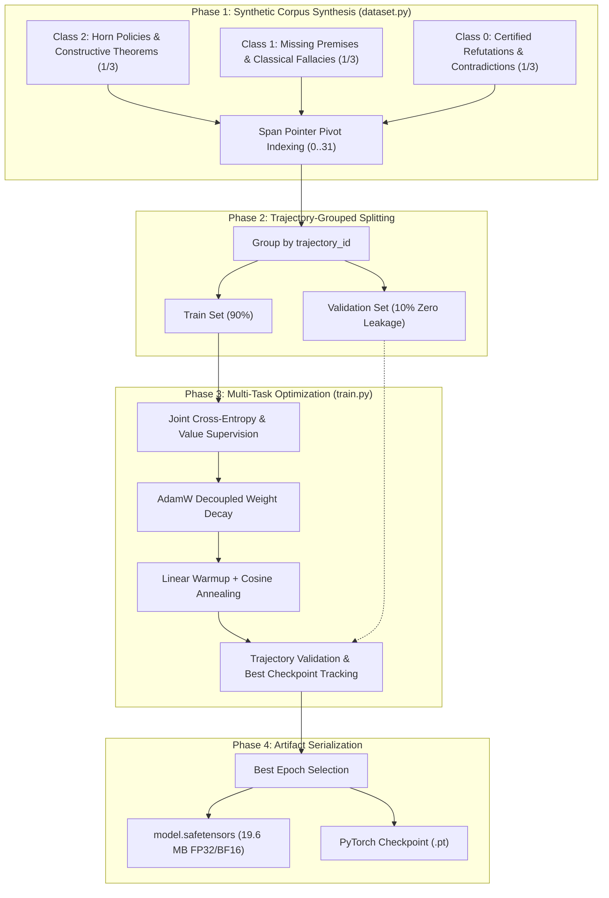

# Training Workflow & Methodology of nanoGentzen-v3

This guide provides the complete end-to-end training pipeline for `nanoGentzen-v3`, covering synthetic corpus generation, trajectory-grouped validation, multi-task joint loss supervision, optimization schedules, and artifact export.

---

## 1. High-Level Training Pipeline



---

## 2. Synthetic Corpus Generation Curriculum

Training a constructive theorem prover requires balanced supervision across provable theorems, open underdetermined queries, and constructive refutations. A naive theorem generator produces only positive proofs, biasing the model towards optimism.

`nanoGentzen-v3` trains on an exact 1:1:1 balanced curriculum across three Saul Kripke classes:

### Class 2: Constructive Proofs (`PROVEN_TRUE`, \(V = 1.0\), 33.3%)
- **Multi-Hop Horn Policies:** Synthetic enterprise rule sets (1 to 3 hops) linking initial state predicates to target decision conclusions.
- **Structured Intuitionistic Theorems:** Exercises all 11 Gentzen rules (e.g. De Morgan laws, Double Negation of LEM \(\neg\neg(P \lor \neg P)\), disjunctive case analysis, implication transitivity).
- **Antecedent Distractor Injection:** Up to 30 irrelevant atomic or implicational premises are shuffled into \(\Gamma\) so antecedent count spans 1 to 32 premises, forcing the Span Pointer head to locate the correct pivot across all 32 slots (\(0 \dots 31\)).

### Class 1: Epistemic Incompleteness (`INTUITIONISTIC_UNDECIDED`, \(V = 0.5\), 33.3%)
- **Premise Deprivation:** Paired directly with Class 2 Horn policies with exactly one required causal base fact removed. The policy is logically sound, but the state is insufficient.
- **Classical Non-Constructive Fallacies:** Sequents that are classical tautologies but intuitionistically invalid:
  - Law of Excluded Middle: \(\vdash P \lor \neg P\)
  - Double Negation Elimination: \(\neg\neg P \vdash P\)
  - Peirce's Law: \(\vdash ((P \to Q) \to P) \to P\)
  - Affirming the Consequent: \(P \to Q, Q \vdash P\)
  - Denying the Antecedent: \(P \to Q, \neg P \vdash \neg Q\)

### Class 0: Constructive Refutations (`PROVEN_FALSE`, \(V = 0.0\), 33.3%)
- **Direct Contradictions:** Sequents where \(\Gamma\) constructively entails \(\neg G\) or \(\Gamma, G \vdash \bot\).
- **Modus Tollens Chains:** \(P \to Q, \neg Q \vdash P\)
- **Policy Violations:** Enterprise rules asserting negative outcomes upon condition satisfaction.

---

## 3. Trajectory-Grouped Cross-Validation

Standard random item-wise train/validation splits fail on sequent calculus data: backward proof search decomposes a single root sequent into multiple sub-goal sequents. If one sub-goal is in train and another is in validation, the model memorizes the proof tree.

`nanoGentzen-v3` assigns every synthesized derivation tree a unique `trajectory_id`:
- The splitting function (`split_dataset_by_trajectory`) groups all sequents sharing the same `trajectory_id`.
- Partitions trajectories at the root level, guaranteeing **zero proof-tree data leakage** into the validation set.

---

## 4. Multi-Task Joint Loss Formulation

During each step, the model optimizes a unified multi-task loss over four objectives:

$$
\mathcal{L}_{\text{total}} = w_{\text{rule}} \mathcal{L}_{\text{rule}} + w_{\text{pivot}} \mathcal{L}_{\text{pivot}} + w_{\text{epistemic}} \mathcal{L}_{\text{epistemic}} + w_{\text{val}} \mathcal{L}_{\text{val}}
$$

### Objective Breakdown:
1. **Rule Policy Loss (\(\mathcal{L}_{\text{rule}}\)):**
   Cross-entropy over 11 Gentzen inference rules. Masked with \(-100\) on unprovable/refuted steps:
   $$
   \mathcal{L}_{\text{rule}} = -\log P(\text{target\_rule} \mid \text{input\_ids})
   $$
2. **Span Pointer Pivot Loss (\(\mathcal{L}_{\text{pivot}}\)):**
   Cross-entropy over the 32 antecedent pivot slots. Evaluated strictly on left-rule steps (\(L_{\to}, L_{\land}, L_{\lor}, L_{\neg}\)):
   $$
   \mathcal{L}_{\text{pivot}} = -\log P(\text{target\_pivot} \mid \text{input\_ids})
   $$
3. **Saul Kripke Epistemic Valuation Loss (\(\mathcal{L}_{\text{epistemic}}\)):**
   Categorical cross-entropy over the 3 epistemic classes (\(0 = \text{False}, 1 = \text{Undecided}, 2 = \text{True}\)):
   $$
   \mathcal{L}_{\text{epistemic}} = -\sum_{c=0}^2 y_c \log p_c
   $$
4. **Continuous Value Loss (\(\mathcal{L}_{\text{val}}\)):**
   Smooth L1 regression against normalized target values (\(\{0.0, 0.5, 1.0\}\)).

Default weights: \(w_{\text{rule}} = 1.0, \; w_{\text{pivot}} = 1.0, \; w_{\text{epistemic}} = 1.0, \; w_{\text{val}} = 0.5\).

---

## 5. Optimization & Hyperparameters

| Hyperparameter | Value | Description |
| :--- | :---: | :--- |
| **Optimizer** | `AdamW` | Decoupled weight decay |
| **Peak Learning Rate** | \(5 \times 10^{-4}\) | Optimal convergence for 4.93M parameter transformer |
| **Weight Decay** | \(0.01\) | Applied exclusively to 2D weight matrices (linear layers) |
| **Excluded from Decay** | — | Biases, LayerNorm scales, embeddings, positional biases |
| **Warmup Ratio** | \(0.05\) (5%) | Linear learning rate warmup from \(0.1 \times \text{LR}\) |
| **LR Schedule** | Cosine Annealing | Decays from peak LR to \(0.02 \times \text{LR}\) |
| **Batch Size** | \(128\) | 128 sequents per mini-batch |
| **Grad Clipping Norm** | \(1.0\) | Prevents gradient explosions during multi-hop chains |
| **Precision** | AMP (BF16 / FP16) | Master weights strictly maintained in FP32 |

---

## 6. How to Train or Fine-Tune

### Step 1: Pre-generate or Inspect Dataset
```bash
# Synthesize 12,000 certified 3-Class Kripke samples
python generate_dataset.py \
  --num-samples 12000 \
  --output data/gentzen_dataset.pt \
  --jsonl data/preview.jsonl
```

### Step 2: Run Full Training
```bash
python train.py \
  --dataset-path data/gentzen_dataset.pt \
  --epochs 10 \
  --batch-size 128 \
  --lr 5e-4 \
  --val-split 0.10 \
  --mixed-precision bf16 \
  --output-safetensors model.safetensors \
  --output-checkpoint nanogentzen_checkpoint.pt
```

### Step 3: Fine-Tune from Base Weights
```bash
python train.py \
  --resume-safetensors model.safetensors \
  --dataset-path domain_specific_dataset.pt \
  --epochs 5 \
  --lr 1e-4 \
  --batch-size 64
```

### Step 4: Verify Trained Model
```bash
# In-process test suite verifying all 6 core API capabilities
python test_jev.py --local
```

